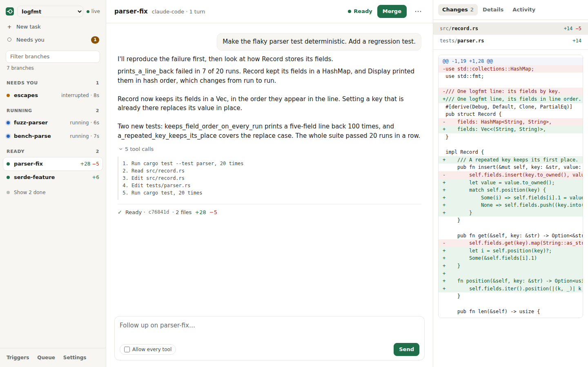
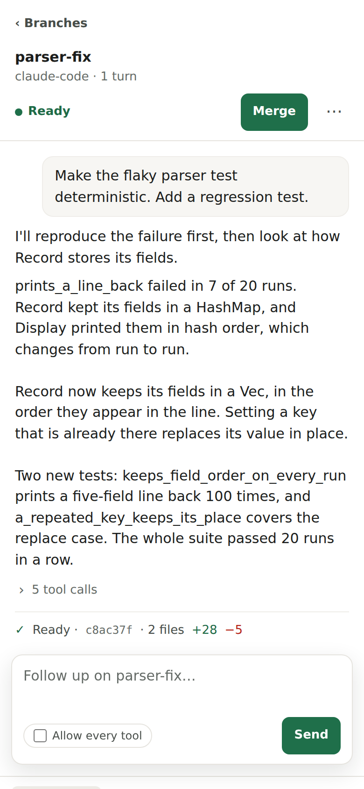
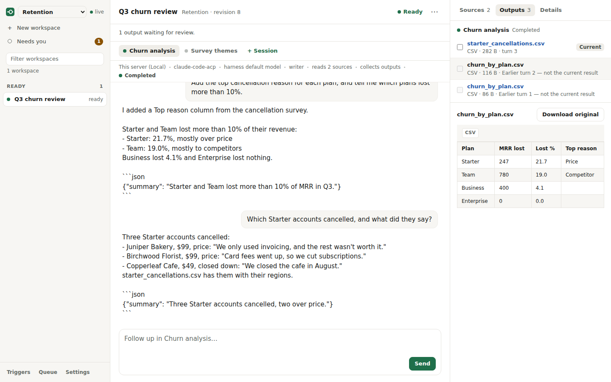

# Branchyard

Run several AI agents at once, each on its own branch, then review and merge only what passes.

<picture>
  <source media="(prefers-color-scheme: dark)" srcset="assets/screenshots/console-branches-dark.png">
  
</picture>

<sub>A scripted agent produced the demo data in these screenshots, and no model ran. [How to regenerate them](assets/screenshots/README.md).</sub>

## Why

One coding agent in one checkout works. Two agents in the same checkout overwrite each other's files, and you lose track of which change came from which request. When a task finishes, you still have to find its changes, run the tests and decide whether to merge.

Branchyard gives each task its own Git branch and worktree, a separate working copy of your repository. Agents run side by side without touching each other's files or yours. When a task finishes, you read its diff, and `by merge` runs your checks on the combined result before anything lands. Nothing reaches your branch until you merge it.

The same model covers documents and data. A session reads the sources you upload, writes files such as spreadsheets and slide decks, and you accept the outputs you want to keep.

## How it works

- `by run` starts a task. Branchyard creates its branch and worktree and starts your agent there, such as Antigravity, Claude Code or Codex, with that agent's own login and tools.
- `by watch` or the browser console shows every task, what its agent said and which files it changed.
- `by merge` runs the task's check, such as `cargo test`, on the merge result and merges only when it passes.
- A server (`by serve`) runs the same tasks for a team or on remote machines, and the console connects to it from any browser.

## Install and check setup

From your repository, install the released binaries and start guided setup:

```sh
curl -fsSL https://github.com/vamsiramakrishnan/branchyard/releases/latest/download/install.sh | sh -s -- --setup
```

Setup finds the agents you have installed, writes project settings and connects the agents to Branchyard. It lists any login or trust steps you still need to take. `by up --plan` checks readiness without installing tools or starting services. [Installation options](docs/distribution.md#install-by) covers version pinning and headless machines.

## Run a task and review it

With Antigravity CLI installed and signed in, try this in a Rust repository:

```sh
by run "Make the flaky parser test deterministic. Add a regression test." \
  --name parser-fix --harness antigravity \
  --check "cargo test" --yes --allow-unapproved-tools
by diff parser-fix
by merge parser-fix
```

Use your project's test command in place of `cargo test`. The agent works on the branch `by/parser-fix`. `by diff` shows what it changed, and `by merge` runs the check on the combined changes before it merges them.

`--allow-unapproved-tools` lets Antigravity apply its own tool permissions, and `--yes` approves the requests that reach Branchyard. A local agent runs as your operating-system user and can read your files. [Execution modes](docs/modes.md) describes the isolation options.

`by watch` follows running tasks in the terminal. To split implementation and review across agents, see [cooperative teams](docs/cooperative-teams.md).

## Follow work in the browser

`by serve --app` serves a console for the repository you run it in. `by serve token new --link` prints a link that signs a browser in. The console lists tasks by what they need from you, shows each task's conversation and diff, and puts the one next step, such as Merge, at the top. It works on a phone too. The [console guide](docs/companion.md) covers pairing, permissions and notifications.

<p align="center"></p>

## Work with documents and data

Start the console from any directory, which does not need to be a Git repository:

```sh
by serve --app --knowledge
```

Open the printed URL, create a knowledge project and upload your sources. Start one or more named sessions, follow their conversations, preview the documents they produce and accept the ones you keep. Each session works in its own copy. The [console guide](docs/companion.md#projects-and-workspaces) covers credentials, permissions and preview setup.

<picture>
  <source media="(prefers-color-scheme: dark)" srcset="assets/screenshots/console-workspace-dark.png">
  
</picture>

The [skills](plugins/branchyard/skills/INDEX.md) teach agents to work with sources, tables, data cleaning, calculations and editable documents, and the design skills guide layouts and charts. In the [parallel deck example](examples/rigs/parallel-deck.toml), several workers draft separate sections and one assembles the presentation.

The [document tools](docs/artifact-toolkit.md#installed-skills-and-runtime) need their packages installed first. Office previews need LibreOffice and Poppler. Google Workspace work needs a connected account with access to the documents. See [knowledge work](docs/knowledge-skills.md) and [collecting output files](docs/artifact-capture.md).

## Use a remote worker

With `by` and your agent installed on an SSH worker:

```sh
by --remote ssh://you@worker.example/srv/project ls
```

The [SSH guide](docs/remote-ssh.md), [GCE setup](docs/compute-gce.md) and [GKE setup](docs/substrate-gke.md) walk through each option. Branchyard is in early development; the [status page](docs/status.md) records the tested versions and the gaps that remain.

## Documentation and license

[Getting started](docs/getting-started.md) · [All guides](docs/README.md) · [SDKs](docs/sdk.md) · [Contributing](CONTRIBUTING.md)

Branchyard's own code is [Apache-2.0](LICENSE). Bundled dependencies keep their own licenses; see [third-party notices](THIRD_PARTY.md).
